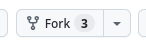
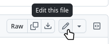
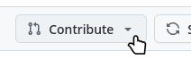

# How To Join

> [!NOTE]
> To join the webring, you need a free [GitHub](https://github.com/) account.

Before adding your site to our list, please allow visitors for your site to visit the previous or next site of the webring by adding the webring navigation menu to your site. [Here](https://webring.webdev-webdesign.com/#embed-heading), you can find a generator that outputs a simple HTML navigation. You don't have to use this generator, but please ensure to add at least a link to the previous and next site as well as the main webring page (the random site link is optional).

Next, you will have to **fork** this repository. Log in to your GitHub account, and click the "Fork" button in our repository.



This will clone the repository to your GitHub account.

After you cloned the repository, you can edit the `src/data/sites.json` file:



Add your site using the following format:

```json
{
  "name": "YOUR WEBSITE'S NAME",
  "url": "A LINK TO YOUR WEBSITE",
  "description": "(OPTIONAL) A SHORT DESCRIPTION OF YOUR WEBSITE",
  "badge": "(OPTIONAL) A LINK TO A 88x31 WEB BADGE REPRESENTING YOUR WEBSITE"
}
```

Add this to the end of the file, before the closing square bracket (`]`). Don't forget to add a comma at the end of the site before.

Now, you can submit your site by creating a Pull Request.



Set the title as "Add site: YOUR SITE" and click "Create". We will check if you added the navigation to your site and merge the Pull Request.
